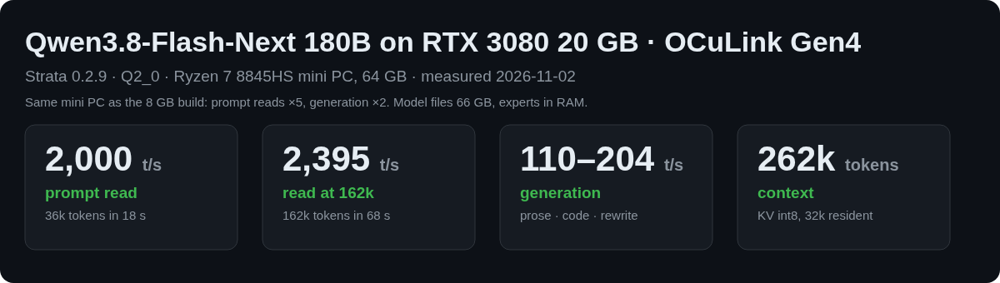
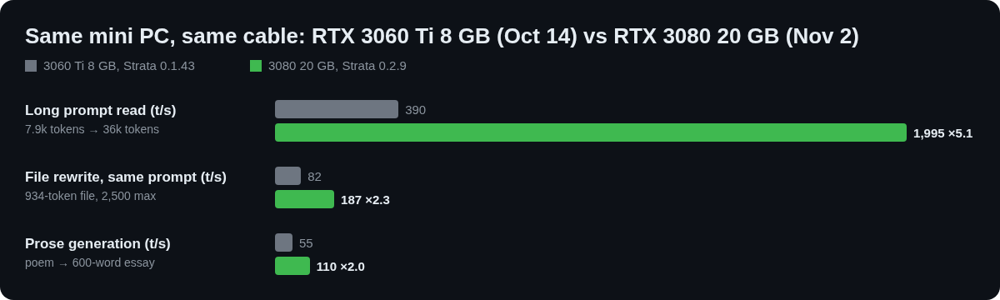
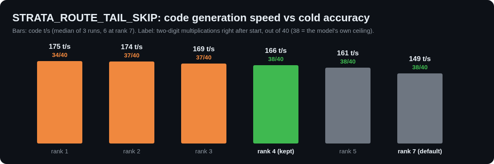

# Qwen3.8-Flash-Next 180B (Strata) on an RTX 3080 20 GB over OCuLink



Dated speed measurements and the full working config for **Qwen3.8-Flash-Next 180B (~6B active)** run with
[Strata](https://github.com/Niko1221/Strata) on a mini PC whose only strong GPU is an **RTX 3080 20 GB attached over
OCuLink (PCIe Gen4 x4)**. Same machine, cable and method as
[emoubarak/strata-flash-next-egpu](https://github.com/emoubarak/strata-flash-next-egpu), which documents the
previous card (RTX 3060 Ti 8 GB). What changed: the GPU, the Strata version, one kernel module and the settings.

The speed and quality tables were measured on this machine on 2026-11-02 with the scripts and frozen prompts in
`bench/`. The gains listed per setting come from the sweeps of Oct 28 to Nov 2 on the same card (Strata 0.2.8 and
0.2.9). Nothing is estimated. Raw runs of the published tables are in `results/`.

## Speed (retained config)

| Test | Prompt read | Generation | Drafts accepted |
|---|---:|---:|---:|
| Prose, 600-word essay (700 tokens) | short prompt | **110 t/s** | 49% |
| New code, ~150-line Python module (700 tokens) | short prompt | **166 t/s** | 85% |
| File rewrite with one rename (700 tokens) | short prompt | **204 t/s** | 99% |
| Same rewrite, whole file (890 tokens) | 934 tokens | 187 t/s, faithful | 661/680 |
| Document, 14,690 tokens | **1,998 t/s** (7.4 s) | 95 t/s | |
| Document, 36,053 tokens (about a Claude Code first turn) | **1,995 t/s** (18.1 s) | 114 t/s | |
| Document, 73,891 tokens | **2,367 t/s** (31.2 s) | 105 t/s | |
| Document, 162,343 tokens | **2,395 t/s** (67.8 s) | 87 t/s | |

- Generation rows: median of 12 runs (4 server starts × 3 passes, `bench_decode.py`), temperature 0, thinking off,
  a random nonce per request so the prompt cache never helps. Min-max: prose 107-115, code 161-173, rewrite 199-205.
- Read rows: one run per depth (`bench_ctx.py`), nothing reused from the cache. Generation after a deep read is
  measured on a short summary (79-88 tokens, 32 at 162k), so it is noisier than the rows above.
- Speeds are the engine's own log lines (`N read in X ms`, `M generated in Y ms`), not wall-clock with HTTP.



Compared with the 8 GB card (October 14, Strata 0.1.43): long prompts read ×5 and stay around 2,000 t/s from 15k to 162k tokens,
the same file rewrite writes ×2.3, prose ×2 (the 8 GB number was the shorter ai-bench poem). The context went from
64k to 262k.

## Quality on this config

| Test | Score |
|---|---|
| 40 two-digit multiplications, cold (right after start), thinking off, temperature 0 | **38/40**, same two misses (36×59, 71×86) as the default settings |
| In-house agentic decision exam, 10 cases × 4 runs | **36/40** (always misses the same one case) |
| File rewrite | faithful (only the requested rename) |
| Tool calls, OpenAI (`tool_calls`) and Anthropic (`tool_use`) APIs | correct |

## Hardware

| Part | Detail |
|---|---|
| PC | Minisforum mini PC, Ryzen 7 8845HS (8C/16T), 64 GB DDR5 (60 GiB seen by Linux, iGPU reserve set to 2 GB in the BIOS) |
| eGPU | RTX 3080 **20 GB** (memory-modded GA102, VBIOS 94.02.27.00.14), 320 W limit, in an OCuLink dock |
| Link | PCIe **Gen4 x4**, measured 6.66 GB/s host→device, 6.58 GB/s device→host |
| VRAM | 721-725 GB/s read measured (95% of the 760 theoretical), 10 min gpu-burn at 19 GB with 0 errors, 60 °C max |
| RAM used by Strata | ~41-45 GiB experts + KV beyond 32k + conversation cache (stop memory-hungry neighbours first) |

Hardware check output: `results/llama.cpp/hardware-check.txt`.

The raw runs in `results/strata/` were recorded with the lab's own copies of these scripts, which use a few
French keys (`reecriture` = rewrite, `fidele` = faithful). The scripts in `bench/` write English keys.

## Software

| Part | Version |
|---|---|
| OS | Fedora 44 Workstation, kernel 7.2.13 |
| NVIDIA driver / CUDA | 615.78.08 / CUDA 13.4 |
| Strata | v0.2.9 (commit `c62d5e3a`, engine 0.1.55), CUDA backend built by `setup.sh` |
| [gpu-unlock](https://github.com/Zagitta/gpu-unlock) | 2.0.0 (commit `7eb51bc`), kernel argument `gpu_unlock.targets=all` |
| Python | 3.14 (Strata venv) |

## Model files (~66 GB)

| File | Source |
|---|---|
| `Qwen3.8-Flash-Next-GSQ-RCO-Q2_0-00001/2-of-00002.gguf` (37.6 + 28.8 GB) | [ISTA-DASLab/Qwen3.8-Flash-Next-GSQ-RCO-GGUF](https://huggingface.co/ISTA-DASLab/Qwen3.8-Flash-Next-GSQ-RCO-GGUF), `Q2_0` subfolder |
| MTP draft head (`mtp/rt/`, 0.9 GB), pack and tokenizer (`packs/q2_0/`) | downloaded by Strata `setup.py` for the Q2_0 pack |
| Refusal direction (480 KB, optional abliteration) | [alesha-pro/Qwen3.8-Flash-Next-abliterated-GSQ-RCO-Strata-GGUF](https://huggingface.co/alesha-pro/Qwen3.8-Flash-Next-abliterated-GSQ-RCO-Strata-GGUF) |

The refusal direction is subtracted from the residual stream at layers 4-44 (`--cvec-mode project`). Drop the four
`--control-vector*`/`--cvec*` arguments for the stock model; speed is the same.

## Retained config

`config/strata-q2_0.template.json` (replace `$HOME`) and `config/env.sh`. Serve with:

```sh
cd ~/src/strata
source /path/to/this/repo/config/env.sh
.venv/bin/python serve/server.py --engine strata --config strata-q2_0.json --port 18090
```

OpenAI API on `http://127.0.0.1:18090/v1`, Anthropic API on `/v1/messages`. First start takes 2-3 minutes.

| Setting | Value | Why (measured here) |
|---|---|---|
| `--expert-cache` | auto | about 9,700 of the 24,576 experts on the card, 930 MiB VRAM left free |
| `--prefill` | **16384** | reads +28 to +47% against `auto` (8,192); 32768 gains nothing and costs expert slots |
| `--spec 4 --spec-min-p 0.5` + `--mtp` head | speculative decoding | generation +37 to +51% against no MTP; `--spec 8` −13%, `--spec 2` same |
| `--max-context` | **262144** | |
| `--kv int8 --kv-resident 32768` | 32k tokens of KV in VRAM, the rest streamed from RAM | gives the 262k window for −5 to −9% read; `q4_0` and `k8v4` KV read slower |
| `--conversation-cache-mib 8192 --conversation-cache-slots 4` | parks up to 4 conversations in RAM | Claude Code with 2 sub-agents: 68 s → 35 s (restore in 36-50 ms instead of re-reading 6 s) |
| `--vram-reserve-mib` | 960 | keeps >512 MiB free during a 162k prompt (723 MiB at the lowest), no paging warning |
| `--prompt-cache-every` | 2048 | checkpoint every 2,048 tokens: agent turns, retries and branches reuse the cached prefix |
| `fit_max_tokens` | true | shrinks `max_tokens` instead of refusing an oversized request |
| `STRATA_PREFILL_CPU_SHARE=1` | CPU computes off-card experts during reads | never slower, generation +2 to +8% |
| `STRATA_KV_PREFETCH=1` | streamed KV uploaded during the previous layer | reads +2.5% (36k) and +4.8% (74k) |
| `STRATA_PREFILL_MMQ=0` | FP16 prompt path | see trap 1; costs 19-24% of read speed, buys reliability |
| `STRATA_ROUTE_TAIL_SKIP=4` | skips an off-card expert that every token in the window ranks 4th or worse | generation +7 / +11 / +16% against the default 7, same cold accuracy (chart below) |
| gpu-unlock | lifts the GeForce half-rate FP16 tensor limit | reads **+16 to +19%** at 15-74k, generation unchanged, same accuracy (38/40) |



`STRATA_ROUTE_TAIL_SKIP` is a rank, not a switch (1 to 9, default 7). Lower = more experts skipped = faster but more
approximate. The errors at ranks 1-3 show up right after start, while the expert cache is cold, then fade: judge
this setting on a freshly started server (`bench_arith.py`), not on a warm one.

`./setup.sh --calibrate --yes` on this card (Oct 29) kept Strata's defaults (114 t/s against 103-105 with the adaptive
settings tuned for the 8 GB card): on 20 GB, generation is bound by the card itself (VRAM bandwidth), not by
moving weights over the cable.

## Variants tested, all rejected

No measurable gain, or a cost: `--prefill 32768`, `--spec 8`, `--kv q4_0` / `k8v4`, `--kv-grow`,
`--expert-cache-per-layer`, `--batch 2 --batch-mtp` and `"parallel": 2` (no faster than the conversation cache, fewer experts on the card),
`--adapt-async 1` (−15 to −24% on one run), `--lookup-chain 2`, `STRATA_PF_W16_CACHE_MIB`, `STRATA_PF_FUSED_Q2N`,
`--pcie-frac 0.55`, `--mtp-q4 all`, `--vram-reserve-mib 768`, a bigger conversation cache.
`STRATA_HC_Q8=1` gave +1 to +4% generation but failed a safety case of the agent exam 2 times in 8: removed.
The Speedy fork (DevDock-AI/Speedy) matches Strata at the same `ROUTE_TAIL_SKIP` rank: the gain first measured
with it here came from running it at rank 1.

## Other models on the same card (llama.cpp)

llama.cpp `de7fa0a`, CUDA build, `-fa 1 -ub 512`, 512-token prompt, 128 generated, 3 repetitions (2026-10-28).
Raw: `results/llama.cpp/`.

| Model | Size | pp512 (t/s) | tg128 (t/s) |
|---|---:|---:|---:|
| Qwen3.5-4B Q4_K_M | 2.5 GiB | 6,107 | 160 |
| Gemma 4 E4B Q4_K_M | 4.6 GiB | 6,105 | 140 |
| LFM2.5-8B-A1B Q5_K_M (MoE) | 5.6 GiB | 10,703 | 350 |
| Qwen3.8-27B IQ2_XXS | 6.8 GiB | 1,263 | 48 |
| Qwen3.6-35B-A3B Q4_K, `--n-cpu-moe 2` | 20.2 GiB | 1,814 | 142 |

Qwen3.6-35B-A3B with 64k context in llama-server: `--n-cpu-moe 6`, KV `q8_0`, 108 t/s
(`results/llama.cpp/qwen36-35b-context-vs-ncmoe.tsv`). CUDA beats Vulkan on this card by 10 to 65%.

## Reproduce

```sh
git clone https://github.com/Niko1221/Strata ~/src/strata
cd ~/src/strata && git checkout v0.2.9
./setup.sh --model qwen3.8-flash-next --family q2_0   # ~66 GB download + CUDA build
./setup.sh --calibrate --yes                          # checks the defaults on YOUR machine
# copy config/strata-q2_0.template.json -> strata-q2_0.json (replace $HOME), source config/env.sh, serve (see above)

cd /path/to/this/repo/bench
LOG=~/src/strata/strata-q2_0.log
python3 bench_arith.py 18090                  # cold accuracy, run first, right after start
python3 bench_decode.py 18090 $LOG mylabel    # generation: prose, code, rewrite
python3 bench_ctx.py 18090 $LOG mylabel 15 40 82 180
python3 bench_rewrite.py 18090 $LOG mylabel
```

gpu-unlock: follow its README (DKMS module + firmware, Secure Boot off, kernel argument
`gpu_unlock.targets=all`, reboot; `dmesg | grep gpu_unlock` must say `unlocked`).

Needs ~46 GiB free RAM and the whole card. Results land in `results/strata/`.

## Traps

1. **NaN loops on some long agent prompts (Strata #879).** With the default int8 MMQ prompt path, one 48k-token agent
   prompt went non-finite at the same position on every retry, about 19 times in a row, and the client got a 503.
   Same card as the upstream report (RTX 3080 20 GB). `STRATA_PREFILL_MMQ=0` fixes it; MMQ reads 23-31% faster
   when it works.
2. **Judge approximate settings cold.** `ROUTE_TAIL_SKIP` ranks 1-3 score 34-37/40 right after start and 38/40 warm.
   A warm benchmark hides the problem.
3. **Keep 512 MiB of VRAM free** during a request, or Strata may page mid-generation (#2065). Check the free VRAM
   line in the engine log after any change to the context, prefill or cache settings.
4. **gpu-unlock does nothing without its kernel argument.** Installing the packages is not enough.
5. Generation varies ±5% between server starts: compare settings in alternation (A B A B, restart each time),
   never one run against one run.

## License

MIT. Benchmark prompt excerpt (`bench/prompt-benchmark.md`) is from Strata's DETAILS.md
([Niko1221/Strata](https://github.com/Niko1221/Strata), MIT).
